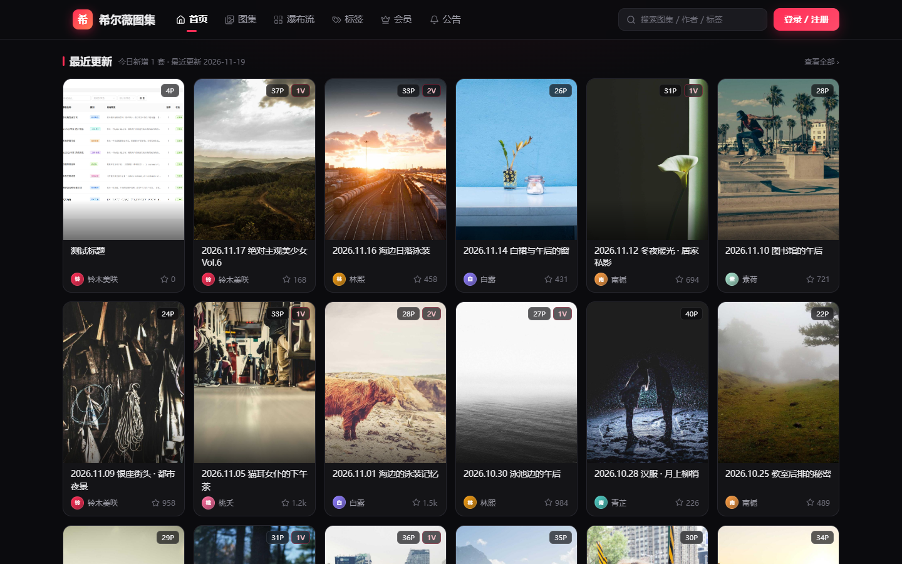
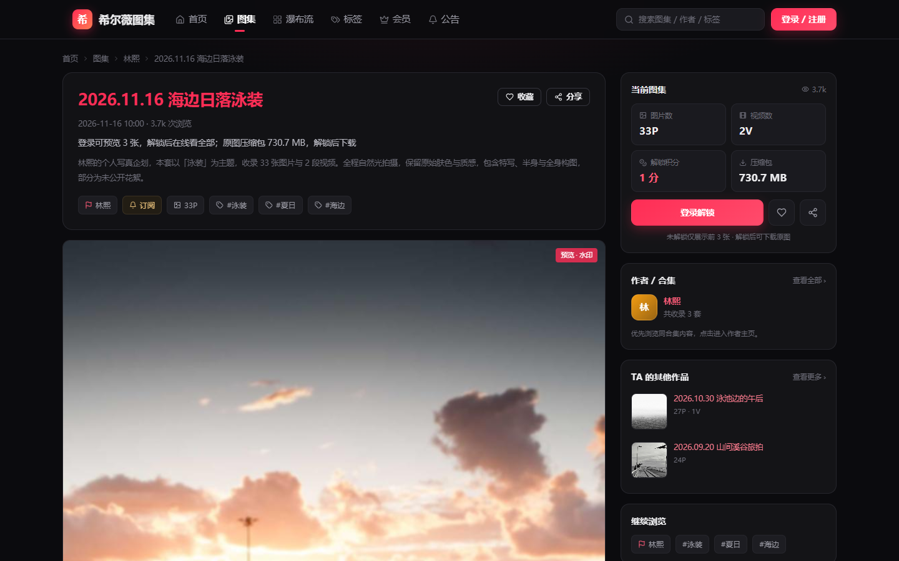
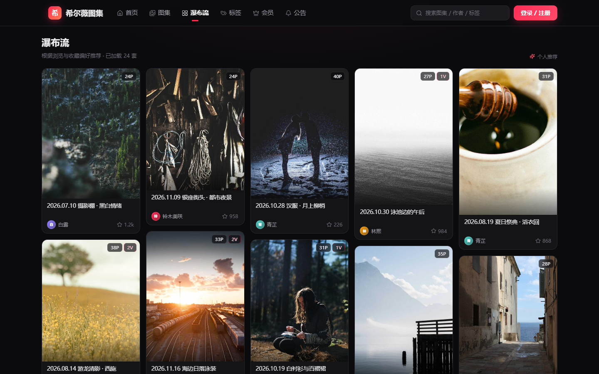
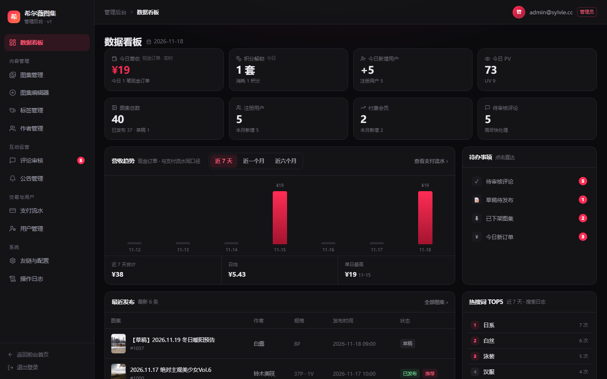
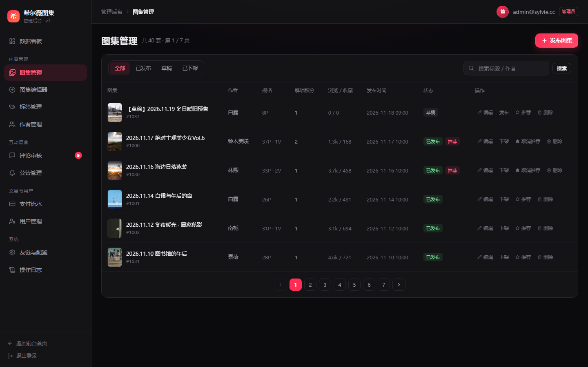
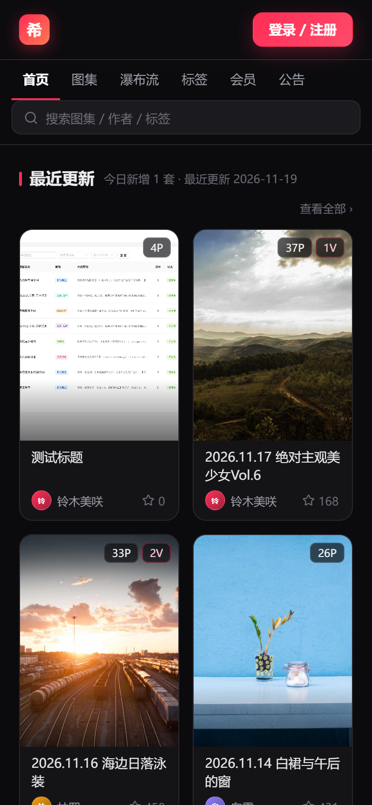
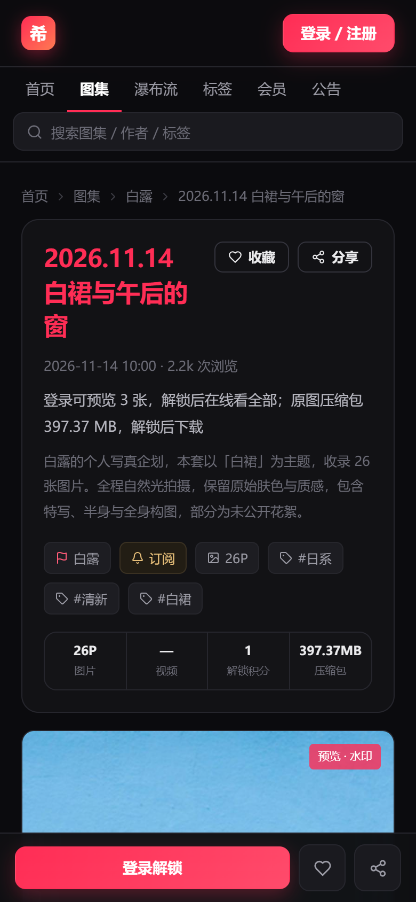

# 希尔薇图集 · 高清写真图集站

> 面向写真图集的浏览、积分解锁与会员订阅站点。
> 前台 Web 与独立管理后台分离部署、各自登录，仅共用同一个 MySQL 数据库。



## 功能特性

- **图集浏览**：首页最近更新、标签 / 作者 / 关键词筛选、收藏与热度排序、瀑布流，以及前台公告弹层。
- **积分解锁**：每日签到获得解锁积分；注册会员消耗 `album.points` 永久解锁单套图集，解锁后重复下载不再扣分，`user.points` 不会为负。
- **会员体系**：付费会员全站畅看与下载，不消耗积分；v1 仅接入支付宝，本地开发默认 `ALIPAY_MOCK=true` 模拟支付，续费在剩余有效期上叠加 30 天。
- **水印预览**：未解锁时只返回前 3 张带水印预览，解锁后及付费会员一律返回原图；全局开关 `image.watermark_on` 只控制未解锁预览。
- **互动与下载**：收藏、作者订阅、评论审核；解锁后可在线查看全部图片并打包 ZIP 下载。
- **独立管理后台**：数据看板、图集编辑 / 发布 / 推荐 / 下架、标签与作者、评论审核、公告、支付流水与退款、用户管理、操作日志与 CSV 导出。
- **一键部署**：Docker Compose 编排 MySQL 8、RustFS、API、Web、Admin，首次启动自动建表并写入演示数据。

## 页面预览

| 图集详情 | 瀑布流 |
| --- | --- |
|  |  |

| 管理后台 · 数据看板 | 管理后台 · 图集管理 |
| --- | --- |
|  |  |

### 移动端

| 首页 | 图集详情 |
| --- | --- |
|  |  |

## 技术栈

- **前台**：Next.js 15（App Router）、React 19、Tailwind CSS v4、SWR
- **管理后台**：React 19、Vite、React Router、Tailwind CSS v4、SWR（独立登录，仅面向桌面端）
- **后端**：Node.js、Hono、Zod、MySQL 8（mysql2 参数化查询）、RustFS（S3 兼容）
- **图片与下载**：Sharp 生成缩略图与水印，archiver 打包 ZIP
- **共享包**：`@sylvie/types`、`@sylvie/db`、`@sylvie/utils`
- **工程**：pnpm workspace + Turborepo、ESLint、Docker Compose

## 快速开始

```powershell
# 一键构建并启动 MySQL + RustFS + API + Web + Admin，等待健康检查
pwsh ./manage.ps1 up
```

访问地址：

- 前台：<http://localhost:8080>
- 管理后台：<http://localhost:8081>
- API：<http://localhost:3000>（健康检查 `/health`）
- RustFS 控制台：<http://localhost:9001>

演示账号密码均为 `123456`：

| 账号 | 角色 | 说明 |
| --- | --- | --- |
| `admin@sylvie.cc` | 管理员 | 后台也可输入简写 `admin` |
| `demo@sylvie.cc` | 注册会员 | 可用于签到与积分解锁流程 |
| `vip@sylvie.cc` | 付费会员 | 全站畅看与下载 |

开发验证码固定为 `123456`。

本地开发（仅用容器跑 MySQL + RustFS，三端热更新）：

```bash
docker compose -f scripts/docker-compose.yml up -d mysql rustfs

cd gallery-monorepo
pnpm install
cp apps/api/.env.example apps/api/.env
pnpm dev:api     # http://localhost:3000
pnpm dev:web     # http://localhost:3001
pnpm dev:admin   # http://localhost:3002
```

也可以直接运行 `pwsh ./manage.ps1 dev` 启动同样的开发环境。

常用运维命令：

```powershell
pwsh ./manage.ps1 status                        # 容器状态与访问地址
pwsh ./manage.ps1 logs -Target api -Follow      # 跟踪 API 日志
pwsh ./manage.ps1 init                          # 重跑建表 SQL 与演示数据
pwsh ./manage.ps1 reset                         # 删除数据卷后重建（清空数据库与对象存储）
```

## 目录结构

```text
sylvie-gallery/
├── gallery-monorepo/
│   ├── apps/
│   │   ├── api/          # Hono API：JWT、MySQL、RustFS、Sharp、ZIP 下载
│   │   ├── web/          # Next.js 前台
│   │   └── admin/        # React + Vite 管理后台
│   └── packages/         # types、db、utils、eslint-config、tsconfig
├── docs/                 # 功能清单、数据库设计、原型与截图
├── scripts/              # Docker Compose、初始化 SQL、演示数据生成
├── manage.ps1            # 启动、构建、日志、重置等运维入口
└── README.md
```

## 文档

- [前台功能清单](docs/美女写真网站-v1功能清单.md)：按页面组织的功能与交互规格
- [管理后台功能清单](docs/美女写真网站-v1管理后台功能清单.md)：后台页面与操作说明
- [数据库设计](docs/美女写真网站-v1数据库设计.sql)：25 张表、设计约定与种子数据
- [前台交互原型](docs/美女写真网站-v1原型设计.html)：单文件 HTML，浏览器直接打开
- [管理后台原型](docs/美女写真网站-v1管理后台原型.html)：单文件 HTML，登录层与前台独立
- [scripts/docker-compose.yml](scripts/docker-compose.yml)：五端容器编排

## License

[MIT](LICENSE)
